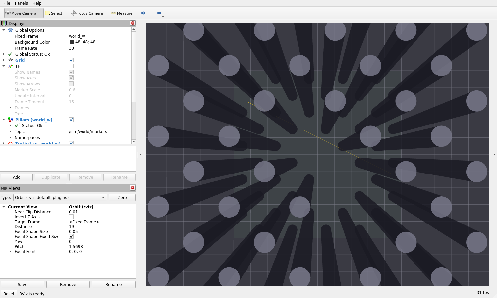
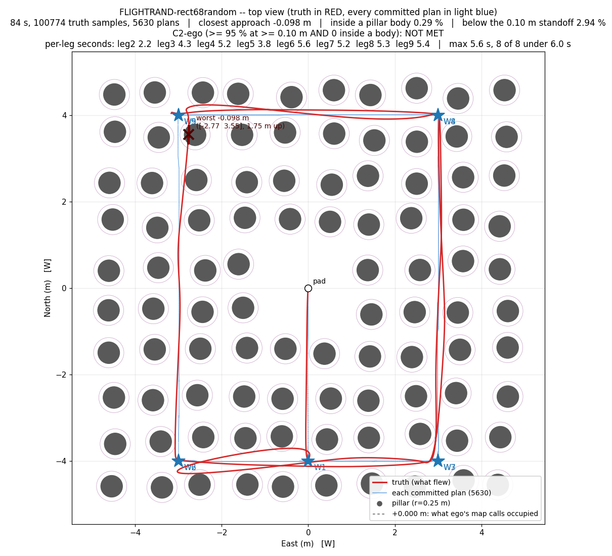

# lio_avoid

LiDAR-inertial odometry flying an ArduPilot Copter SITL in a simulated pillar forest, with a flight stack whose
responsibilities are **separate processes**: a PLAN box that decides the mission, a BRIDGE that carries the
estimator feed and the setpoints to the flight controller, and a SUPERVISOR that owns arming, take-off, the safety
gates and the abort — on **its own MAVLink endpoint**, so it is a watchdog and not a passenger. Everything flies
on external navigation: **no GPS, no compass** — the EKF's position, velocity and yaw all come from the LIO.

Two missions live in this repository, and they are different worlds:

| | **Mission A** — frozen | **Mission B** — current |
|---|---|---|
| route | 2.0 × 1.2 m rectangle, 5.0 s hover at every corner | **6 × 8 m rectangle, two laps**, 9 waypoints |
| plan box | `src/planner/rectangle_source.py` (waypoints, velocity = 0) | **`ego_planner_node`** (B-spline through a 0.1 m occupancy lattice) behind `src/planner/ego_contract_shim.py` |
| world | `worlds/pillars.yaml` | `worlds/rect68.yaml` — 46 pillars r = 0.30 m, **10 m tall**, every route edge exactly **+0.200 m** clear |
| release | tag `mission-a-rect46`, `frozen/mission_a.manifest`, `rviz/mission_a.rviz` | `docs/STATUS.md`, `docs/PLAN.md`, `rviz/mission_b.rviz` |

## The pipeline, as flown today (Mission B)

```
   46 pillars + the SIMULATED Livox MID-360
   (the SAME world file the sortie is scored in)
                │  /livox/lidar + /livox/imu   (10 Hz / 200 Hz, frame mid360_link)
                ▼
   super_lio_node ──► /lio/robo/odom   200 Hz, pose only,      frame "world"  (= L)
                  ──► /lio/odom         10 Hz, pose + twist
                  ──► /lio/cloud_world  the registered scan
                │
                ├──► cloud_relay.py ──► /ego/cloud          0.10 m lattice, L
                │
                ▼
   fcu_pose_feed.py ◄── /fcu/odom (the FCU's OWN MAVLink LOCAL_POSITION_NED #32, W)
                  ──► /ego/odom_fcu    L, pose + velocity ──► ego_planner_node
                                                             │  planning/bspline
                                                             ▼
                                                          traj_server (p + v + a, 100 Hz)
                                                             │  /plan/cmd  (quadrotor_msgs/PositionCommand, L)
                                                             ▼
   ego_contract_shim.py  ── tour + arrival gate + reference shaping (limits and continuity ONLY; no controller)
                                                             │
                                                             ▼
   bridge_node.py ──► MAVLink 84 @50 Hz, type_mask 2048 (pos + vel + acc + yaw) ──► ArduPilot Copter SITL
   supervisor.py  ──► class 76 only: arm, take-off, the go, geofence on TRUTH, plan-silence abort, LAND
   truth tap      ◄── UDP 1200 Hz from the SITL (the truth, never on the control path)
```

## Start here

| file | what it is |
|---|---|
| `docs/STATUS.md` | **the living record**: every claim with its number and its denominator, and what is NOT achieved |
| `docs/PLAN.md` | the goal, the decisions, the acceptance rows, and §3.6-3.7 — the measured frontier of Mission B |
| `docs/ARCHITECTURE.md` | the components, topics, transports and the responsibility split |
| `docs/FRAMES.md` | the coordinate conventions (W / L / F / B / S) and where the ONE conversion lives |
| `docs/metrics/` | the evidence files: raw tool output for each round, each naming its run directory |
| `rviz/` | `mission_a.rviz` (frozen) and `mission_b.rviz` (Mission B) — see §4 |
| `frozen/rect46-release.txt` | **the frozen version** this repo is published at, and how to roll back to it |
| `firmware/README.md` | the built SITL binary, the truth-tap patch and the `waf` recipe |

## 1. Environment and build

The runtime is WSL Ubuntu 22.04 with ROS 2 Humble. `env.sh` is the one place for the interactive environment
(`LIO_AVOID_ROOT`, the CUDA path that lets CuPy compile kernels, `PATH`).

```bash
source /opt/ros/humble/setup.bash
source ~/lio_avoid/lio_ws/install/setup.bash          # super_lio, livox driver, quadrotor_msgs
source env.sh                                        # CUDA_PATH for the ray-caster (see §4 for its two ROS settings)
```

Build, from a clean checkout (each command was run and is what the sorties were built from):

```bash
# 1. the SITL binary: upstream dbe7921 + the truth-tap patch (firmware/README.md pins both)
cd ~/lio_avoid/src/ardupilot && ./waf copter

# 2. the LIO and the message package.  lio_ws/src symlinks THIS repo's src/quadrotor_msgs and the Super-LIO
#    checkout; a rebuild is `colcon build`, and it is cheap.
cd ~/lio_avoid/lio_ws && colcon build --symlink-install

# 3. ego's packages (external checkout, pinned in docs/ARCHITECTURE.md)
cd ~/lio_avoid/planner_ws && colcon build --symlink-install --packages-select ego_planner

# 4. our launch file INTO that checkout, then rebuild + verify it (74 declared / 0 undeclared is a PASS)
python3 src/tools/install-ego-launch.py --run
```

`install-ego-launch.py` exists because the ego package symlinks its launch files individually: a new
`ego_on_lio.launch.py` is invisible to `ros2 launch` until the package is rebuilt, and a launch file that sets a
parameter the node never declares does nothing and says nothing. `--static` checks the names offline; `--run` also
starts the node and asks it.

## 2. Fly a sortie

One command starts everything — SITL, the truth tap, the LiDAR simulation, the LIO, the recorders, the planner
route, the bridge, the supervisor — and writes one log directory per sortie. The launcher refuses to start while
another sortie is alive.

```bash
# MISSION B, the arm of record (as committed; every number in docs/STATUS 229-231 is this command).
# Run it from the repository root.
ALT_MODE=lio NAV_SOURCE=lio WORLD="$PWD/worlds/rect68.yaml" \
MISSION_PARM="$PWD/params/phase_a_mission_fast.parm" \
EKF_PARM="$PWD/params/ekf_trust_lio_measured.parm" \
GEOFENCE_M=6.60 TAKEOFF_COMMAND_M=0.2 VERTICAL_FIRST=1 VERTICAL_HOLD_S=3.0 \
PLANNER=ego EGO_CLOUD_WINDOW=0.0 \
EXTRA_PARM="$PWD/params/guided_limits_fast.parm" \
    bash src/tools/run-mission.sh rect68-default
```

```bash
# MISSION A, the frozen configuration (the sortie the tag was promoted on)
ALT_MODE=lio NAV_SOURCE=lio WORLD="$PWD/worlds/pillars.yaml" \
MISSION_PARM="$PWD/params/phase_a_mission_fast.parm" \
EKF_PARM="$PWD/params/ekf_trust_lio_measured.parm" \
GEOFENCE_M=6.60 TAKEOFF_COMMAND_M=0.2 VERTICAL_FIRST=1 VERTICAL_HOLD_S=3.0 \
    bash src/tools/run-mission.sh rect46-frozen
```

**The owner's random forest** (`worlds/rect68_random.yaml`, generated by `src/tools/make-random-forest.py`): 1 m
cells with **one pillar of r 0.25 m at a random position inside each cell**, the take-off area in the centre empty,
96 pillars, min surface gap 0.284 m -- the same tour, the same arm, only the field different:

```bash
WORLD="$PWD/worlds/rect68_random.yaml" ... bash src/tools/run-mission.sh rand-01     # same env as Mission B above
```

**What one sortie writes** (to `/home/fanxin/lio_avoid/logs/missionA-<TAG>/`, not into this repository):
`tap.csv` (truth, 1200 Hz), `lio.csv`, `setpoints.csv` (the wire, 50 Hz), `wire.csv`, `traj.csv` (+ `.cmd.csv`,
`.points.csv`), `phase.csv` (the leg/phase timeline), `shim_trace.csv`, `cloud.csv`, `flight.BIN`, one log per
process (`sitl.log`, `lio.log`, `ego_planner.log`, `traj_server.log`, `ego_relay.log`, `fcu_pose_feed.log`,
`supervisor.log`, `bridge.log`, …) and **`metrics.txt`**, the acceptance rows.

### The knobs (all optional; the committed defaults are in the right-hand column)

| variable | meaning | default |
|---|---|---|
| `PLANNER` | `rectangle` (Mission A) · `ego` (Mission B) · a path to any `.py` that speaks `/plan/cmd` | `rectangle` |
| `WORLD` | the world file — the pillars, the tour, the arena | `worlds/pillars.yaml` |
| `MISSION_PARM` / `EKF_PARM` | FCU parameter files (the EKF trust table is what makes the LIO the navigation source) | `params/phase_a_mission.parm` / none |
| `NAV_SOURCE` / `ALT_MODE` | who supplies the navigation / where the altitude comes from — both missions fly `lio` / `lio` | `lio` / `baro` |
| `GEOFENCE_M` | the supervisor's geofence radius, applied to the **truth** | from the world |
| `EXTRA_PARM` | **one** extra FCU parameter file, appended LAST to `--defaults` (never as a second `--defaults`: two of those replace each other) | none |
| `BRIDGE_FIELDS` | which of pos / vel / acc reach the FCU | `posvelacc` |
| `EGO_MAX_VEL` / `EGO_MAX_ACC` | the plan's **soft** speed/acceleration ceiling | `2.5` / `2.5` |
| `EGO_INFLATION` / `EGO_RESOLUTION` | ego's obstacle inflation and lattice | `0.0` / `0.1` |
| `EGO_REPLAN_S` / `EGO_NOREPLAN_M` | ego's re-plan period and its own arrival meter | `0.5` / `1.0` |
| `EGO_ARRIVE_M` / `EGO_SETTLE_MPS` | the shell's arrival gate (horizontal) and the speed it also requires | `0.30` / `0.0` |
| `EGO_REF_ACC_MAX` / `EGO_REF_SLEW_MPS` / `EGO_REF_CLAMP_M` | reference continuity: acceleration clamp, slew limit, maximum distance ahead of the vehicle | `2.0` / `6.0` / `1.2` |
| `EGO_CORNER_M` / `EGO_CORNER_MPS` | the corner governor: within this radius of a corner the reference is capped at this speed | `0.50` / `1.10` |
| `EGO_CORRIDOR_M` | the reference is held this far (half-width) from the current leg's centreline | `0.01` |
| `EGO_EMERGENCY_S` | `fsm/emergency_time` — 0.0 turns a freeze into a re-plan | `0.0` |
| `EGO_REF_Z_CLAMP_M` / `EGO_REF_Z_FLOOR_M` | the reference's altitude band | `0.6` / `0.6` |
| `EGO_CONTRACT` | `shim` (ego's own `traj_server` + our tour/contract shell) or `adapter` (our sampler) | `shim` |
| `EGO_CLOUD_WINDOW` / `EGO_CLOUD_VOXEL` / `EGO_SELF_BLIND` | the relay: seconds of scans unioned, lattice, self-blind bubble | `0.0` / `0.10` / `0.0` |

`EXTRA_PARM` is the one-variable lever: it changes the FCU side without touching a frozen file. The arm of record's
file is `params/guided_limits_fast.parm` (`PSC_NE_POS_P` 2.0, `ATC_ANG_RLL_P`/`ATC_ANG_PIT_P` 6.0, `WP_ACC` 8.0,
`PSC_NE_JERK` 100.0, `WP_SPD` 4.0, `ATC_ANGLE_MAX` 40.0) — each line carries the measurement that chose it.

## 3. Every command in this repository

### 3.1 Fly / bring up

| command | what it does |
|---|---|
| `src/tools/run-mission.sh [TAG]` | **the sortie**: everything in §2, one log directory, `metrics.txt` at the end |
| `src/tools/run-mission-batch.sh [N] [PREFIX]` | N sorties in a row plus a summary that carries "how many of how many" for every row |
| `src/tools/sitl-parked.sh [SECONDS] [--defaults PARM]` | SITL parked + the truth tap only: drift, yaw offset, the tap's rates. Exit status is the PASS/FAIL |
| `src/tools/sitl-lio.sh [PARKED] [MOVING]` | SITL + the LIO alone, measured against the tap (the estimator gate, no arming) |
| `src/tools/sim-sensors.sh [SCANS]` | SITL + `truth_rx` + `lidar_imu` live: the sensor chain with no estimator |
| `src/tools/sim-pillar-gate.sh [SECONDS]` | the accumulated clouds against the world file's surfaces — the **mount/frame gate**, before any LIO exists |
| `src/tools/sim-ros-check.sh [SECONDS]` | the truth receiver in ROS mode: rates, `/sim/rtf`, the TF broadcast, one `/sim/truth/odom` message decoded |
| `src/tools/run-fcu-link-test.sh` | the FCU link with **no LIO**: GUIDED + arm + take-off + hold, fed straight from the tap |
| `python3 src/tools/make-random-forest.py` | regenerates `worlds/rect68_random.yaml` (the owner's forest — 1 m cells, r 0.25 m, random in cell, centre empty) byte for byte |

### 3.2 ego's pieces, one at a time (the same wiring the sortie uses)

| command | what it does |
|---|---|
| `ros2 launch ego_planner ego_on_lio.launch.py [args]` | `ego_planner_node` alone, wired to our odometry and scan. `--show-args` lists every knob (map box, ceiling, `max_vel`, `lambda_fitness`, `emergency_time`, …) |
| `ros2 run ego_planner traj_server --ros-args -p traj_server/time_forward:=1.0` | the only `quadrotor_msgs/PositionCommand` producer in ego's tree — the **Route B** sampler. `time_forward` must be set: its own default is −1.0, a yaw look-ahead into the past |
| `python3 src/planner/cloud_relay.py --in /lio/cloud_world --out /ego/cloud --window 0.0 --voxel 0.10` | decimates the registered scan onto ego's lattice (`--selftest` runs offline) |
| `python3 src/planner/fcu_pose_feed.py --calib-file _stage/calib.json --in /fcu/odom --out /ego/odom_fcu` | the FCU's own estimate, W → L, so the planner and the controller close their loops on ONE state |
| `python3 src/planner/ego_contract_shim.py --world worlds/rect68.yaml --calib-file _stage/calib.json …` | the tour + `trajectory_id`/`trajectory_flag` + reference shaping (`--selftest` runs offline) |
| `python3 src/planner/ego_source.py --world worlds/rect68.yaml …` | the `adapter` route: our sampler instead of `traj_server` |
| `python3 src/planner/rectangle_source.py --world worlds/pillars.yaml …` | the Mission A plan box |
| `src/supervisor/supervisor.py …` · `src/bridge/bridge_node.py …` | started by `run-mission.sh`; both take `--help` |

### 3.3 Offline checks (no simulator, no ROS graph)

| command | what it proves |
|---|---|
| `python3 src/tools/frozen-check.py` | **53 of 53** mission-A artifacts byte-for-byte unchanged (the tag's manifest) |
| `python3 src/tools/docs-budget.py` | every doc file is registered and within its budget |
| `python3 src/tools/check-doc-citations.py` | every `file:line` in the docs resolves to a real line |
| `python3 src/tools/test-lint.py` | no undefined name anywhere (a crash on a path no test walks) |
| `python3 src/tools/test-layout.py` | the repository layout is consistent |
| `python3 src/tools/test-planner-knob.py` | the `PLANNER=` knob really selects the planner |
| `python3 src/tools/test-planner-swap.py` | the `/plan/cmd` contract is planner-independent |
| `python3 src/planner/ego_contract_shim.py --selftest` | the shell: ids per waypoint, the post-COMPLETED hold, yaw latch, the corridor wall |
| `python3 src/planner/cloud_relay.py --selftest` · `src/planner/fcu_pose_feed.py --selftest` · `src/planner/ego_source.py --selftest` | the relay's lattice, the W→L conversion, the adapter's sampler |
| `python3 src/tools/selftest-bridge.py` · `test-bridge-contract.py` · `test-cmd-stream.py` · `test-supervisor-authority.py` · `test-stall-gate.py` · `test-bspline-mutations.py` | the bridge's frames and masks, the wire contract, the stream, the supervisor's authority, the stall gate, and the B-spline selftest's teeth |
| `bash src/tools/run-convention-tests.sh` | the W/L/F/B/S conventions **against a live SITL**: three spawn headings, plus a deliberate `flip-enu` mutation that MUST fail |

### 3.4 Reading a recording

Most of these take a sortie directory (`logs/missionA-<TAG>`, written here as `<run>`) and print numbers, not
pictures; the few that name `tap.csv` / `lio.csv` take the files themselves.

| command | what it answers |
|---|---|
| `python3 src/tools/metrics.py --tap tap.csv --odom lio.csv --phase phase.csv --world worlds/rect68.yaml` | the acceptance rows (A1/A2 route rms, A4 FCU-vs-truth, B1 box, C1, C2) — this is what writes `metrics.txt` |
| `python3 src/tools/acceptance-table.py <run> [<run> …]` | the same rows for several sorties, side by side |
| `python3 src/tools/plot-run.py <run-dir> --out DIR` | the top view and the traces |
| `python3 src/tools/traj-clearance-audit.py <run> --world worlds/rect68.yaml` | the PLAN's own clearance, sample by sample |
| `python3 src/tools/corner-excursion.py <run> …` · `corner-dwell-trace.py <run> corner` · `dwell-audit.py <run>` · `hover-table.py <run>` | the corner behaviour: excursions, dwell, the hover table |
| `python3 src/tools/plan-vs-truth.py --run <run>` | the plan against the aircraft, in one frame |
| `python3 src/tools/command-vs-intended.py <tag> …` | what the wire carried against what the plan asked |
| `python3 src/tools/world-info.py --world worlds/rect68.yaml` | the field's own numbers (pillar lattice, route clearance, tour) |
| `python3 src/tools/bin-triage.py <flight.BIN>` · `bin-lag.py` · `bin-params.py` · `bin-vs-tap.py` · `bin-extnav-rate.py` | the FCU's own log: the loop's rates, lags and parameters |
| `python3 src/tools/lio-vs-truth.py --tap tap.csv --odom lio.csv` · `lio-attitude.py` | the estimator against the truth |
| `python3 src/tools/sortie-score.py <run-dir>` · `batch-summary.py <dir-or-glob>` | one sortie / a batch, scored |

## 4. RViz: watching it live

There are **two saved views**, and they are for two different stacks:

| file | fixed frame | what it shows | needs |
|---|---|---|---|
| `rviz/mission_a.rviz` (frozen) | `world_w` | Mission A: the pillars, the simulated Livox cloud, the truth | `/sim/world/markers`, `/sim/truth/odom` |
| `rviz/mission_b.rviz` | `world_w` | **Mission B**: pillars, truth, LIO odometry, the FCU estimate, the registered scan, ego's inflated map, ego's plan and goal | one static transform (below) |

```bash
# terminal A: fly (§2).   terminal B, the SAME shell environment:
python3 src/sim/world_markers.py --world worlds/rect68.yaml &      # the 46 pillars, latched
ros2 run tf2_ros static_transform_publisher \
     --x -0.00080 --y -0.00409 --z 0.11557 --yaw 1.5716650 \
     --frame-id world_w --child-frame-id world &
rviz2 -d rviz/mission_b.rviz
```



### Why the transform, and why exactly that one

**There is no TF in this stack, on purpose** (`src/planner/ego_on_lio.launch.py` says so): every consumer already
speaks one frame and nothing transforms anything. What is on the wire is *three labels for two sets of numbers*:

| label | who publishes it | numbers are in |
|---|---|---|
| `world_w` | `sim/world_markers.py`, `sim/truth_rx.py` | **W**, the mission frame of the world file |
| `world` | `super_lio_node` (odometry and clouds), ego's `plan_vis` markers | **L**, the LIO frame |
| `lio_world` | `fcu_pose_feed.py`, ego's grid map | **L**, identical to `world` |

L and W differ by the calibration in `_stage/calib.json` — **yaw +90.049771°**, t = (−0.00080, −0.00409, +0.11557) m
(rms 17.7 mm over 45 589 samples) — so the command above is that transform and nothing else: parent `world_w`,
child `world`, i.e. `p_W = Rz(+90.049771°) p_L + t`. It was **verified against the recordings** rather than assumed:
applied to a sortie's own `/lio/robo/odom`, it lands on the truth tap to **p50 16-17 mm, p90 31-34 mm**, while the
same comparison *without* it is **4.6-4.9 m** out. A viewer that forgets the transform sees the L-frame items a
quarter turn and half the field away — or, more often, nothing at all: RViz then reports
`No transform from [world] to [world_w]` in the display's status and draws nothing in the wrong place.

### The topics, and how RViz must subscribe to them

| topic | type | published by | frame | what to expect |
|---|---|---|---|---|
| `/sim/world/markers` | `visualization_msgs/MarkerArray` | `sim/world_markers.py` (**not** started by a sortie) | `world_w` | the 46 pillars; **latched** — Reliability `Reliable`, Durability `Transient Local`, depth 1 |
| `/sim/truth/odom` | `nav_msgs/Odometry` | `sim/truth_rx.py` | `world_w` (+ TF `world_w→truth_base_link`) | the SITL's own state, ~60 Hz, Best Effort |
| `/lio/robo/odom` | `nav_msgs/Odometry` | `super_lio_node` | `world` (= L) | 200 Hz, **pose only** (its twist is identically zero) |
| `/lio/odom` | `nav_msgs/Odometry` | `super_lio_node` | `world` | 10 Hz, pose **and** the twist ego's FSM gates on |
| `/lio/cloud_world` | `sensor_msgs/PointCloud2` | `super_lio_node` | `world` | the registered scan, Best Effort |
| `/ego/cloud` | `sensor_msgs/PointCloud2` | `cloud_relay.py` | `world` | the same scan on ego's 0.10 m lattice, Reliable |
| `/ego/odom_fcu` | `nav_msgs/Odometry` | `fcu_pose_feed.py` | `lio_world` | the **FCU's** estimate converted to L — the state ego actually plans on |
| `drone_0_plan_vis/optimal_list`, `/a_star_list`, `/goal_point`, `/global_list`, `/init_list` | `visualization_msgs/Marker` | ego's `plan_vis` | `world` | the committed B-spline, the A\* reference, the goal |
| `drone_0_plan_vis/*_array` | `visualization_msgs/MarkerArray` | ego's `plan_vis` | `world` | the same, in the array form |
| `drone_0_grid/grid_map/occupancy_inflate` | `sensor_msgs/PointCloud2` | ego's grid map | `lio_world` | the inflated occupancy the planner avoids |
| `/livox/lidar` | `sensor_msgs/PointCloud2` | `sim/lidar_imu.py` | `mid360_link` | the raw simulated scan **in the sensor frame**; it has no place in the world until you supply the body pose, so the view ships it disabled |
| `/plan/cmd` | `quadrotor_msgs/PositionCommand` | `traj_server` + the shim | L | **not** displayable by stock RViz (no plugin); the reference is in `traj.csv.cmd.csv` |

### Two traps, both measured

1. **Do not export `RMW_IMPLEMENTATION` / `ROS_DOMAIN_ID` for a sortie.** With `rmw_cyclonedds_cpp` + domain 42 +
   `ROS_LOCALHOST_ONLY=1`, `ego_planner_node` dies at start-up — `Failed to find a free participant index for domain
   42` → `rcl node's rmw handle is invalid`, exit −6 — and the sortie ends in 30 s with no metrics. Every sortie in
   `docs/metrics/` was flown with the ROS 2 defaults; start RViz **in the same shell** so it lands on the same graph.
   (This is exactly what went wrong on the first attempt at the screenshot above; `env.sh` carries those two
   variables for the interactive shell, so unset them before a sortie: `source env.sh && unset RMW_IMPLEMENTATION
   ROS_DOMAIN_ID`.)
2. **`import -window root` cannot read WSLg's root window.** Capture the RViz window instead:
   `import -window "$(xdotool search --name rviz | tail -1)" shot.png`.

## 5. The frozen version

```bash
git switch --detach mission-a-rect46     # the frozen Mission A release (promoted-EKF configuration)
python3 src/tools/frozen-check.py        # 53 of 53 frozen artifacts unchanged
git switch main
```

`frozen/mission_a.manifest` pins every mission-A artifact by SHA-256 and is checked before every commit;
`frozen/rect46-release.txt` says what the version is, which sortie is its reference, and what the parts that do
**not** live in this repository are pinned to (the ArduPilot commit, the Super-LIO commit, the LIO→world
calibration file). Mission B never touches it: adding `rviz/mission_b.rviz` and `docs/` rows leaves all 53
artifacts byte-identical.

## 6. What is outside this repository (and therefore named, not shipped)

| piece | where | pinned as |
|---|---|---|
| ArduPilot checkout | `~/lio_avoid/src/ardupilot` | `dbe7921` + `src/patches/apm-0001-sitl-truth-tap.patch` |
| Super-LIO | `~/lio_avoid/src/Super-LIO` (+ `lio_ws`) | `f89f48d`, `liblio.so` md5 `e4b82a73cbfb70a7a538514f74936b09` |
| ego-planner-swarm | `~/lio_avoid/planner_ws` | see `docs/ARCHITECTURE.md`; our launch file is installed by `src/tools/install-ego-launch.py` |
| LIO → world calibration | `_stage/calib.json` | md5 `399390f7b08905bd3cf1be5164505fb4` (yaw +90.049771°, t = [−0.00080 −0.00409 +0.11557] m) |
| flight recordings | `~/lio_avoid/logs/missionA-<tag>/` | one directory per sortie (§2) |

## 7. The result, honestly

**Mission A (frozen).** The reference sortie `RECT46-accept-promoted` reports **A1 3.37 mm** route accuracy,
**A2 1.86 mm**, the FCU's own estimate **A4 8.04 mm**, **4 of 4 corners hovered ≥ 5.0 s**, **0 of 60 336 samples
inside the 0.20 m pillar footprint** (minimum pillar-surface distance 0.569 m), landed and disarmed — and **B1
fails**: the truth's box over the route is E 2.113 m against a 2.10 m bound, because the position loop rings at
every corner arrival. That failure is documented with its mechanism and two costed candidates in
`docs/metrics/b1-approach-shaping-20261016.txt`; no threshold was ever moved to make a row pass.

**Mission B (current).** The arm of record, flown **seven times bare** (nothing but `EXTRA_PARM`):

| | value | how many of the seven |
|---|---|---|
| collision clause (min clearance > 0, C2-ego MET) | +0.038 / +0.016 / +0.033 m | **3** — the other four are −0.039 … −0.209 m |
| time clause (every leg ≤ 6 s) | max leg 5.57 / 5.79 / 5.91 s | **3** |
| both clauses in the same sortie | — | **0** |

The contacts are all at **corners**: the worst sample of every failing sortie is 0.55-1.5 m from a corner, and the
inside-body samples cluster there (53-61 % within 0.6 m) — the vehicle swings wide as it turns, where the margin
is 0.407 m against 0.200 m along the edges. The corner-speed direction is refuted at the current gains (corner
1.00 m/s: −0.261 m, 2.57 % inside). `docs/PLAN.md` §3.6-3.7 states the frontier; `docs/STATUS.md` rows 229-231 are
the measurements behind it. **No threshold was moved, and the two clauses are 0 of 7 together.**

**The owner's random forest** (`worlds/rect68_random.yaml`, 96 pillars r 0.25 m, random in 1 m cells, centre
empty) is a second bench, and the first sortie on it met the **time clause 8 of 8 (max 5.63 s)** with the tour
complete — and failed the safety clause by **−0.098 m**, 82 % of the offending samples within 0.6 m of a corner,
i.e. the same event on a field whose legs are 6.5 cm tighter (PLAN §3.8).



## 中文导览

这是一个"把 LIO 当唯一导航源"的 ArduPilot Copter SITL 飞行栈：**PLAN（计划）/ BRIDGE（桥）/ SUPERVISOR（监督）
三个独立进程**，监督者自带独立 MAVLink 端点、只管解锁/起飞/放行/安全门/迫降，全程无 GPS、无罗盘。

两个任务：**任务 A**（2.0×1.2 m 矩形、角点悬停 5 s）已冻结在 tag `mission-a-rect46`；**任务 B**（6×8 m 矩形两
圈、9 个航点、46 根柱子的雷区）是当前在做的，规划器是 `ego_planner_node`，外壳 `ego_contract_shim.py` 只做限
幅与连续性（**没有任何 PID**）。

- 先看 `docs/STATUS.md`（每一条结论都带数字与分母，以及**没做到什么**），再看 `docs/PLAN.md` §3.6-3.7（边界）
- **跑一次**：§2 的 `run-mission.sh` 一条命令起全部；日志在 `~/lio_avoid/logs/missionA-<TAG>/`
- **看图**：§4 的 `rviz/mission_b.rviz`（要配一条静态 TF，原因见 §4）+ `rviz/mission_a.rviz`（冻结的旧视图）
- **所有命令**：§3 的四张表（起飞/ego 各部件/离线检查/回放分析）
- 冻结版本：`git switch --detach mission-a-rect46`，说明在 `frozen/rect46-release.txt`
- 固件在 `firmware/`（上游 `dbe7921` + 一个真值 tap 补丁，含二进制与复现步骤）
- 图只看 `docs/figures/*.png` 的俯视图；其余诊断图在 `docs/figures/archive/`
